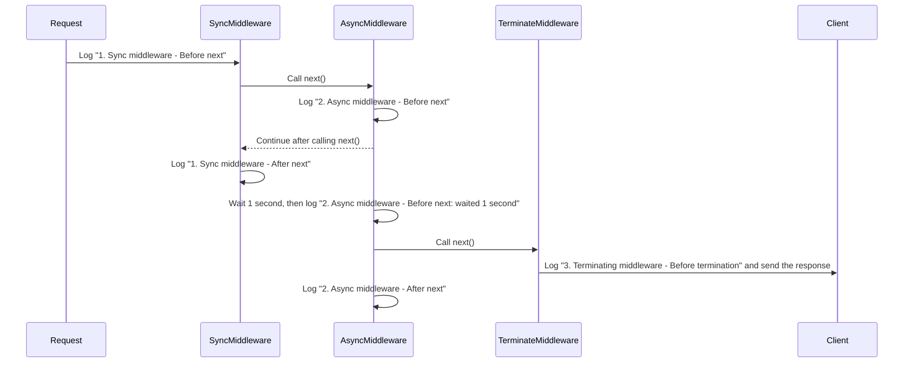

> **A bit of background:**  
> I recently got assigned a feature to build on a Koa backend at work. Most of my day-to-day work is on the frontend, but I'd used Express a little as a student. Since both are well-known Node.js web frameworks, the code didn't feel entirely unfamiliar. They have plenty in common, but working with Koa showed me just how different their design choices and day-to-day experience can be.

<!-- truncate -->

## **Introduction** {#簡介}

**Express** is the best-known and most downloaded Node.js web framework. Released in 2010, it was among the first web frameworks built specifically for Node.js. Its approachable API, useful features, and wealth of community resources quickly made it a go-to tool. It helped the Node.js ecosystem grow and influenced the design of many frameworks that followed.

In 2013, the team behind Express introduced a new framework: **Koa**. Koa focuses on a small, simple core, leaving out built-in middleware so developers can choose the modules they need. One of its defining features is native async/await support, which addresses some of Express's limitations around synchronous and asynchronous operations. Express middleware, by comparison, is callback-based: its `next()` function executes synchronously and can't wait for downstream middleware to finish in the way Koa can. We'll look at examples of this later.

This post brings together what I learned about the core differences between Express and Koa. If you've ever been digging through documentation and had that little “Oh, that's how it works!” moment, I hope you'll find a few of those here too.

<br/>

## **Built-in Features** {#框架的內建功能}

### **Express: Ready to Use** {#express開箱即用}

If you've used Express, you probably know how convenient it is. It comes close to being a complete framework, with enough built-in functionality to get a project running without hunting down lots of third-party packages. It also provides handy methods for common tasks:

- `express.Router()`: Flexible routing.
- `express.static()`: Setting up static file serving.
- `express.set()`: Application settings.
- `express.json()` and `express.urlencoded()`: Built-in body parsers for JSON and URL-encoded request bodies.

Here's a simple example:

```jsx title="src/index.ts"
const express = require('express');
const app = express();

app.use(express.json()); // Built-in body parser
app.get('/', (req, res) => {
  res.send('Hello from Express!');
});

app.listen(3000, () => console.log('Express server running on http://localhost:3000'));
```

This sets up a basic HTTP server in just a few lines. We can handle routing and request parsing without installing any additional third-party packages.

### **Koa: A Minimal Core** {#koa極簡核心}

**Koa** takes a different approach: keep the core as small as possible. It includes no default middleware, so even basic routing and body parsing require separate packages. This gives us a lot of freedom to assemble an application around our own needs.

Koa is particularly useful for HTTP services that don't need extensive routing, such as webhooks or chatbots. It doesn't impose a structure, so we can choose the middleware that fits the task.

Here's how to add routing and a body parser to Koa:

```jsx title="src/index.ts"
const Koa = require('koa');
const Router = require('@koa/router');
const bodyParser = require('koa-bodyparser');

const app = new Koa();
const router = new Router();

app.use(bodyParser()); // The body parser must be added separately

router.get('/', (ctx) => {
  ctx.body = 'Hello from Koa with Router and Body Parser!';
});

app.use(router.routes()).use(router.allowedMethods());

app.listen(3000, () => console.log('Koa server running on http://localhost:3000'));

```

We need to install packages such as `@koa/router` and `koa-bodyparser` ourselves to cover functionality Express includes. That keeps Koa's core simple and gives us plenty of control. Of course, that freedom also means more decisions and setup, which can take some getting used to if you're used to getting a project running quickly.

<br/>

## **Handling Requests and Responses** {#requestresponse-處理方式}

### **Express: The `req` and `res` Objects** {#express使用-req-和-res-物件}

In Express, requests and responses revolve around `req` (Request) and `res` (Response). Express builds these on Node.js's native `http.IncomingMessage` and `http.ServerResponse`, adding properties and methods that make development easier.

`req` exposes request data through properties such as:

- `req.body`: Data from a POST request.
- `req.params`: Route parameters.
- `req.query`: URL query parameters.

The `res` object handles the response:

- `res.send()`: Sends a response.
- `res.json()`: Sends a JSON response.
- `res.status()`: Sets the HTTP status code.

Here's a simple Express example:

```jsx title="src/index.ts"
const express = require('express');
const app = express();

app.use(express.json()); // Parse JSON request bodies

app.get('/greet/:name', (req, res) => {
  const name = req.params.name;
  res.status(200).json({ message: `Hello, ${name}!` });
});

app.listen(3000, () => console.log('Express server is running on http://localhost:3000'));
```

### **Koa: The `ctx` Context Object** {#koa使用-ctx-上下文物件}

Koa handles requests and responses through `ctx` (Context). It brings `request` and `response` together under one clean API.

Each request gets its own `ctx`, through which we can read or modify the request and response. Koa wraps Node.js's native `req` and `res` as `ctx.request` and `ctx.response`, adding functionality along the way.

Common request operations include:

- `ctx.request.body`: Accessing POST data, with koa-bodyparser.
- `ctx.params`: Accessing route parameters, with a router such as @koa/router.
- `ctx.query`: Accessing URL query parameters.

For responses:

- `ctx.body`: Sets the response body.
- `ctx.status`: Sets the HTTP status code.

Here's a simple Koa example:

```jsx title="src/index.ts"
const Koa = require('koa');
const Router = require('@koa/router');
const bodyParser = require('koa-bodyparser');

const app = new Koa();
const router = new Router();

app.use(bodyParser()); // Parse JSON request bodies

router.get('/greet/:name', (ctx) => {
  const name = ctx.params.name;
  ctx.status = 200;
  ctx.body = { message: `Hello, ${name}!` };
});

app.use(router.routes()).use(router.allowedMethods());

app.listen(3000, () => console.log('Koa server is running on http://localhost:3000'));
```

Beyond `ctx.request` and `ctx.response`, `ctx` provides useful helper methods and properties for everyday tasks:

- **`ctx.querystring`**: Returns the raw query string. For `http://localhost:3000/greet?name=John&age=30`, this is `"name=John&age=30"`.
- **`ctx.throw(status, message)`**: Throws an error to simplify error handling. For example, `ctx.throw(400, 'Bad Request')` interrupts downstream middleware at that point and returns a 400 status with an error message.
- **`ctx.state`**: A shared object for passing data between middleware. Authentication middleware might set user information here for later business logic to use.
- **`ctx.is(types)`**: Checks whether the request's Content-Type matches the given types. For example, `ctx.is('json', 'text')` checks for JSON or plain text.

<br/>

## **How Middleware Executes** {#中介層middleware的執行機制}

Middleware processes a request before it reaches a route handler, or handles work before the response goes out. Common uses include logging, authentication, error handling, and body parsing. It makes an application more modular and easier to extend and maintain. Think of a series of gatekeepers: each handles one part of the request, breaking the application logic into small, clear steps.

There's a key difference in how Express and Koa approach this:

1. **Express** middleware is **callback-based**, and `next()` executes synchronously. Code after `next()` continues without waiting for downstream asynchronous middleware to finish.
2. **Koa** middleware is **Promise-based**, with support for `async/await`. At `await next()`, execution pauses until downstream middleware finishes, then resumes with the following code. This follows the “onion model” and makes asynchronous flow easier to follow.

### **The Onion Model** {#洋蔥模型}

Before we look more closely at the two implementations, let's introduce the **onion model**, the basis of Koa's middleware design. A request passes through the outermost middleware and works its way inward, layer by layer. Once the inner work is done, execution returns outward through those same layers. This familiar diagram illustrates the idea:


We can divide this into two phases:

1. **Entering**: Code before `next()` runs from the first registered middleware to the last.
2. **Returning**: Code after `next()` runs in reverse, from the last registered middleware back to the first.

### **Express: Linear, Synchronous Execution** {#express線性同步執行}

As mentioned earlier, **Express** follows a linear, synchronous middleware model. Middleware runs in registration order, passing control onward through `next()`. With asynchronous operations, though, that synchronous behavior can make the execution order a little surprising.

**An example to follow**  
This example mixes synchronous and asynchronous Express middleware:

```tsx title="src/middleware/testMiddleware.ts"
import { Request, Response, NextFunction } from "express";

export const syncMiddleware = (
  req: Request,
  res: Response,
  next: NextFunction
) => {
  console.log("1. Sync middleware - Before next");
  next();
  console.log("1. Sync middleware - After next");
};

export const asyncMiddleware = async (
  req: Request,
  res: Response,
  next: NextFunction
) => {
  console.log("2. Async middleware - Before next");
  await new Promise<void>((resolve) =>
    setTimeout(() => {
      console.log("2. Async middleware - Before next: waited 1 second");
      resolve();
    }, 1000)
  ); // Simulate asynchronous work
  next();
  console.log("2. Async middleware - After next");
};

export const terminateMiddleware = (
  req: Request,
  res: Response,
  next: NextFunction
) => {
  console.log("3. Terminating middleware - Before termination");
  res.send("Request terminated by middleware");
  // Do not call next(); end the request here
};
```

**Output**

```
1. Sync middleware - Before next
2. Async middleware - Before next
1. Sync middleware - After next
2. Async middleware - Before next: waited 1 second
3. Terminating middleware - Before termination
2. Async middleware - After next
```

If Express is new to you, that output may take a moment to make sense of. Why does `1. Sync middleware - After next` run before `2. Async middleware - Before next: waited 1 second`?

**What's happening**  
Express middleware is **callback-based**. Calling `next()` immediately passes control to the next middleware, but the code after it doesn't wait for that middleware's asynchronous work to finish. If we broke the flow down into callbacks, it would look roughly like this:

```jsx
((req, res) => {
  console.log("1. Sync middleware - Before next");
  ((req, res) => {
    console.log("2. Async middleware - Before next");
    // Start the asynchronous work and wait
    (async (req, res) => {
      console.log("2. Async middleware - Before next: waited 1 second");
      await new Promise((resolve) => setTimeout(resolve, 1000));
      ((req, res) => {
        console.log("3. Terminating middleware - Before termination");
        res.send("Request terminated by middleware");
      })(req, res);
      console.log("2. Async middleware - After next");
    })(req, res);
  console.log("1. Sync middleware - After next");  // This runs before the asynchronous result is ready
})(req, res);

```

If that still feels a bit hard to follow, this sequence diagram shows the order inside the middleware:



:::tip
Some articles describe Express middleware as a `FIFO Queue` (first in, first out), but I find that misleading. The actual order depends on whether asynchronous operations are involved.

**LIFO behavior with synchronous operations**  
Without asynchronous work, the order around `next()` is closer to a **LIFO** (last in, first out) call stack. `next()` passes control inward; once all the entry logic has run, execution returns from the last middleware back through the earlier ones, just as a stack unwinds.

**Asynchronous operations and the event loop**  
With operations such as `setTimeout` or `Promise`, the order becomes more involved. Asynchronous tasks enter the event queue and run when the main thread is available. The JavaScript **event loop** therefore affects middleware execution:

1. **Entering**: Synchronous logic runs in registration order until it reaches asynchronous work.
2. **Asynchronous work**: Tasks wait in the event queue while the main thread continues processing other middleware.
3. **Returning**: When the asynchronous tasks finish, the main thread regains control and continues with the code after `next()`.

Express middleware is therefore more than a simple FIFO queue: it combines **LIFO behavior** for synchronous calls with **asynchronous scheduling** through the event loop.
:::

### **Koa: The Onion Model** {#koa洋蔥模型}

Now that we've seen Express's linear, synchronous approach, let's look at **Koa**. Its **onion model** makes the order clear and predictable: outside in, then inside out.

**An example to follow**  
Here's a simple Koa middleware example:

```tsx title="src/middleware/testMiddleware.ts"
import { Context, Next } from "koa";

export const syncMiddleware = async (ctx: Context, next: Next) => {
  console.log("1. Sync middleware - Before next");
  await next();
  console.log("1. Sync middleware - After next");
};

export const asyncMiddleware = async (ctx: Context, next: Next) => {
  console.log("2. Async middleware - Before next");
  await new Promise<void>((resolve) =>
    setTimeout(() => {
      console.log("2. Async middleware - Before next: waited 1 second");
      resolve();
    }, 1000)
  );
  await next();
  console.log("2. Async middleware - After next");
};

export const terminateMiddleware = async (ctx: Context, next: Next) => {
  console.log("3. Terminating middleware - Before termination");
  ctx.body = "Request terminated by middleware";
  // Do not call next(); end the request here
};
```

**Output**:

```
1. Sync middleware - Before next
2. Async middleware - Before next
2. Async middleware - Before next: waited 1 second
3. Terminating middleware - Before termination
2. Async middleware - After next
1. Sync middleware - After next
```

**What's happening**  
Koa's **Promise-based** middleware follows this order:

1. **Entering (outside in)**: `await next()` passes control to the next middleware.
2. **Returning (inside out)**: Once the inner middleware finishes, control returns to the current middleware and execution continues after `next()`.

Compared with Express, Koa's middleware order is much easier to predict. Whether the logic is synchronous or asynchronous, it goes outside in, then inside out. That gives us a more manageable flow. It's especially useful with asynchronous work, where the clearer control flow leaves us with less to keep in our heads.

<br/>

## **A Closer Look at Middleware Execution** {#中介層middleware執行細節探討}

### **Express: Pitfalls Around Sending a Response** {#express回應與中介層執行的陷阱}

In Express, sending a response with a method such as `res.send()` ends the request flow, without continuing to subsequent middleware or code. Accidentally calling `next()` after sending the response can produce this error:

```
Error: Cannot set headers after they are sent to the client
```

The response headers have already been sent, so they can't be changed again. We need to take care with logic after a response and avoid unnecessary calls to `next()`.

**Example**:

```tsx title="src/middleware/testMiddleware.ts"
import { Request, Response, NextFunction } from "express";

export const terminateMiddleware = (
  req: Request,
  res: Response,
  next: NextFunction
) => {
  console.log("3. Terminating middleware - Before termination");
  res.send("Request terminated by middleware");
  next(); // Causes this error: Cannot set headers after they are sent to the client
};

```

**Expected output**:

```
1. Terminating middleware - Before termination
Express Error: Error: Cannot set headers after they are sent to the client
```

:::caution[Design Considerations]
When writing Express middleware:

1. **Ending the chain**: Avoid calling `next()` after the response logic finishes.
2. **Error responses**: When sending an error response, such as `res.status(500).send()`, stop passing responsibility to subsequent handlers.
3. **Clear control flow**: Keep response handling explicit and controlled throughout the middleware chain to avoid unexpected errors from misusing `next()`.
:::

### **Koa: Continuing After Setting a Response** {#koa回應後的執行與控制}

**Koa** allows downstream middleware to keep running even after `ctx.body` has been set. This gives us the flexibility to do more work after preparing a response, such as logging or cleanup.

**Example**:

```tsx title="src/middleware/testMiddleware.ts"
import { Context, Next } from "koa";

export const terminateMiddleware = async (ctx: Context, next: Next) => {
  console.log("3. Terminating middleware - Before termination");
  ctx.body = "Request terminated by middleware";
  await next(); // Downstream middleware still runs after ctx.body is set
};

export const logMiddleware = async (ctx: Context, next: Next) => {
  console.log("4. Logging middleware - Running");
  await next();
  console.log("4. Logging middleware - Complete");
};
```

**Expected output**:

```markdown
3. Terminating middleware - Before termination
4. Logging middleware - Running
4. Logging middleware - Complete
...
```

:::info[Key Behavior]
1. **Continued execution**: Setting `ctx.body` doesn't prevent downstream middleware from running, unless the flow is interrupted, for example by throwing an error.
2. **Flexibility**: After setting the response, we can still perform tasks such as:
    - **Logging**: Recording request and response information.
    - **Cleanup**: Releasing database connections or clearing temporary data.
    - **Monitoring**: Collecting performance data or tracing requests.
:::

<br/>

## **Error Handling** {#錯誤處理}

### **Error Handling in Express** {#express-的錯誤處理}

Express has two kinds of middleware:

- **Regular middleware** takes `(req, res, next)` and handles normal request and response logic.
- **Error-handling middleware** takes `(err, req, res, next)` and must declare all four parameters. Express recognizes this signature and uses it to catch and handle application errors.

When Express sees the four-argument signature `(err, req, res, next)`, it treats the function as error-handling middleware and runs it when:

- Middleware or a route handler calls `next(error)`.
- Code throws an exception, such as `throw new Error(...)`.

When an error occurs, Express skips subsequent regular middleware and goes straight to error-handling middleware.

**An error-handling example**

Here's how that looks in Express:

```jsx title="src/index.ts"
app.use((req, res, next) => {
  console.log("First middleware - Before next");
  next(new Error("Simulated error"));
  console.log("First middleware - After next"); // This line still runs
});

app.use((req, res, next) => {
  console.log("Second middleware");
  next(); // This line does not run because the error has been passed to error-handling middleware
});

// Error-handling middleware must come after all other middleware and routes
app.use((err, req, res, next) => {
  console.error("Error caught:", err.message);
  res.status(500).send("An error occurred");
});
```

**Output**:

```
First middleware - Before next
First middleware - After next
Error caught: Simulated error
```

:::info[Things to Keep in Mind]
1. **What `next(error)` does**:
    - It skips regular middleware and passes control to error-handling middleware.
    - It doesn't stop the calling middleware's code from running. Logic after `next()` still executes, such as the `After next` log in the example.
2. **Where error-handling middleware goes**:
    - Put it after all other middleware and routes; otherwise, it won't catch their errors.
3. **Throwing exceptions**:
    - An explicit `throw` also triggers error-handling middleware, as `next(error)` does.
:::

:::note[Why Does Error-Handling Middleware Need to Come Last?]
As discussed earlier, Express uses a linear execution model: `next()` passes control to the next middleware or route. If the error handler comes earlier, it can't correctly catch errors passed forward by `next(error)`.
:::

### **Error Handling in Koa** {#koa-的錯誤處理}

**Koa** takes a fundamentally different approach. Native `async/await` and `try...catch` make the flow more straightforward. Each layer can catch and handle errors without requiring separate, dedicated error-handling middleware.

**How it works**

- **Catching with `try...catch`**: Each middleware can catch exceptions with `try...catch`. Uncaught errors propagate to the application-wide error listener.
- **Stopping the flow**: When an error occurs, execution doesn't continue with the code after `next()`, preventing unnecessary work.
- **Application-wide error listener**: `ctx.app.emit('error', err, ctx)` passes errors to a shared listener for centralized handling.

**Example**:  
Here's a simple example using `try...catch` in Koa:

```tsx title="src/index.ts"
import Koa, { Context, Next } from 'koa';

const app = new Koa();
// Application-wide error listener
app.on('error', (err, ctx) => {
  console.error('Application-wide error listener caught:', err.message);
  // Add logging, notifications, or other handling here
});

// Regular middleware with try...catch to catch errors
app.use(async (ctx: Context, next: Next) => {
  try {
    console.log('First middleware - Before next');
    await next(); // Pass control to the next middleware
    console.log('First middleware - After next'); // This line does not run if an error occurs
  } catch (err) {
    console.error('First middleware caught:', err.message);
    ctx.status = 500;
    ctx.body = 'A server error occurred';
    ctx.app.emit('error', err, ctx); // Send the error to the application-wide listener
  }
});

// Middleware that simulates an exception
app.use(async (ctx: Context, next: Next) => {
  console.log('Second middleware - Before throw');
  throw new Error('Simulated error'); // Throw an error explicitly
  console.log('Second middleware - After throw'); // This does not run
});

app.listen(3000, () => {
  console.log('Koa server is running on http://localhost:3000');
});
```

**Output**:

```
First middleware - Before next
Second middleware - Before throw
First middleware caught: Simulated error
Application-wide error listener caught: Simulated error
```

**Client response**:

```
A server error occurred
```

**Following the control flow:**  
When the second middleware throws an error, execution goes straight to the first middleware's `catch` block. It sets the HTTP status to 500 and returns an error message, skipping the code after `next()` in the first middleware. This interrupts the normal flow so the error can be handled appropriately.

Beyond `try...catch`, `ctx.app.emit('error', err, ctx)` sends an error event to the application's shared error listener. This is especially useful in larger applications: logging or notifications can be handled in one place rather than repeated in every middleware.

In this example, calling `ctx.app.emit('error', err, ctx)` causes `app.on('error', …)` to receive the event and handle it as needed.

<br/>

## **Reference** {#reference}

- [**Express vs Koa**](https://medium.com/@gary92.gs/express-vs-koa-e48458020ce4)
- [**Understanding the Design Differences Between Express.js and Koa.js**](https://medium.com/cow-say/%E9%87%90%E6%B8%85-express-js-%E5%92%8C-koa-js-%E7%9A%84%E8%A8%AD%E8%A8%88%E5%B7%AE%E7%95%B0-7f95c9f5d596)
- [**The Differences Between Express.js and Koa 2, Two Lightweight Node.js Frameworks**](https://johnnywang1994.github.io/book/articles/js/express-vs-koa.html#nodejs-%E8%BC%95%E9%87%8F%E9%96%8B%E7%99%BC%E6%A1%86%E6%9E%B6-expressjs-%E8%88%87-koa2-%E7%9A%84%E5%8D%80%E5%88%A5)
- [**A Look at Middleware Design in Koa and Express**](https://blog.xav1er.com/p/middleware-of-koa-and-express/)
- [**Koa vs Express**](https://github.com/koajs/koa/blob/master/docs/koa-vs-express.md)
