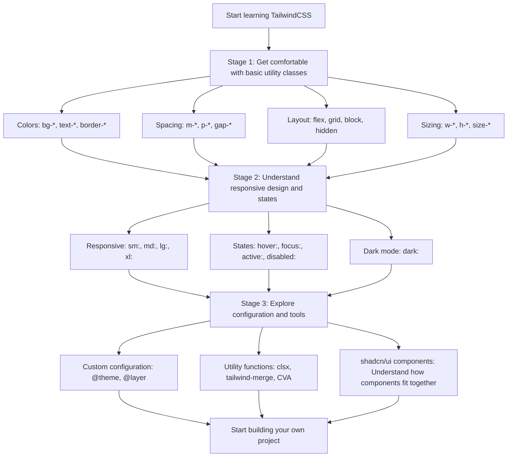

<!-- truncate -->

## **Introduction** {#前言}

Since shadcn/ui arrived in 2023, it has swept through the React ecosystem. Within a year, this “UI library that isn't a UI library” had become something nearly every frontend developer was talking about. It was even named GitHub's hottest open-source project of 2023. If you work with React, you've probably felt that wave yourself.

Over the past two years, just about every well-known React YouTuber and creator has talked about shadcn. More and more beginners are choosing **shadcn/ui** as their first UI toolkit, passing over established options like **Bootstrap**, **MUI**, and **Ant Design**. Some even skip traditional CSS and go straight to **TailwindCSS**. Frontend trends really do move fast (please slow down, I can barely keep up 🥲). I've used **MUI** from my first encounter with React through my first full-time job. Three years ago, it was still one of the defining component libraries in the React ecosystem. Now, with everyone trying shadcn—and even AI-generated React projects including it by default—I figured it was time to give it a go myself. If you can't beat them, join them 😎.

As a longtime MUI user, I can feel a clear difference in the development experience. shadcn does have an edge in appearance and customization, but from my own experience learning it, I wouldn't call its learning curve gentle for beginners. It isn't a traditional UI library, after all. It's a collection of **component templates you copy into your project**, built around **TailwindCSS**. Without a solid grasp of TailwindCSS, it's easy to end up knowing how to copy a component but not how to change it—or relying on AI for every adjustment.

That's why I wanted to write this series: to fill in some key TailwindCSS knowledge for myself and anyone else getting started with shadcn. Taking the time to understand the basics, its design philosophy, and how it works underneath makes the experience much smoother.

This is a full learning series on TailwindCSS and shadcn/ui, split into five articles:

1. **From MUI to a Utility-First Mindset (this article)**
2. [Understanding How TailwindCSS Works](/en/blog/tailwindcss-knowledge-before-shadcn-ui-2)
3. [A Quick Reference to TailwindCSS v4's Built-in Utility Classes](/en/blog/tailwindcss-knowledge-before-shadcn-ui-3)
4. [Customizing a Design System with @theme](/en/blog/tailwindcss-knowledge-before-shadcn-ui-4)
5. [Understanding shadcn/ui's Design System](/en/blog/tailwindcss-knowledge-before-shadcn-ui-5)
6. [The shadcn/ui Ecosystem and Toolchain](/en/blog/tailwindcss-knowledge-before-shadcn-ui-6)

These articles cover questions I ran into while learning, including:

- **Shifting from MUI to TailwindCSS**
- **Getting the environment configured correctly**
- **The TailwindCSS toolchain**
- **Implementing theme switching**

## **The Utility-First Design Philosophy** {#utility-first的設計哲學}

After using MUI for a long time, I'm very used to writing components like this:

```tsx
import { Button } from "@mui/material";

function MyComponent() {
  return (
    <Button variant="contained" color="primary">
      Click me
    </Button>
  );
}
```

This is a typical **component-based** approach: use a component that's already packaged for you, then control its appearance through props.

TailwindCSS takes a **utility-first** approach:

```tsx
function MyComponent() {
  return (
    <button className="bg-blue-500 text-white px-4 py-2 rounded hover:bg-blue-600">
      Click me
    </button>
  );
}
```

You have a range of utility classes to choose from: `bg-blue-500` for the background color, `text-white` for the text color, `px-4` for horizontal padding, `py-2` for vertical padding, and `rounded` for rounded corners. Combine them to build the appearance you want.

:::tip
Utility-first doesn't mean you stop using components. You compose styles with utility classes first, then extract components where needed. That difference in order shapes your development workflow.
:::

## **The Rise of TailwindCSS and shadcn/ui** {#tailwindcss-的崛起與-shadcnui-的爆紅現象}

### **Why Has TailwindCSS Gained Ground?** {#tailwindcss-為什麼會崛起}

More companies want their own design systems and brand identities, rather than products that look like another Material Design or Bootstrap site. The one-size-fits-all appearance of traditional component libraries can become a constraint. Heavily customizing an existing component library is often more complicated than starting from scratch. TailwindCSS offers one way forward: a complete design vocabulary—tokens for spacing, colors, font sizes, and so on—without imposing a particular look. That makes it a good fit for building your own design system.

### **Maintaining TailwindCSS vs. Traditional CSS** {#tailwindcss-與傳統-css-的維護性差異}

Here's a problem you can run into with traditional CSS:

```css
/* styles.css */
.button-primary {
  background-color: #3b82f6;
  color: white;
  padding: 0.5rem 1rem;
  border-radius: 0.375rem;
}

.button-primary:hover {
  background-color: #2563eb;
}

/* Three months later, the project might have 50 similar classes... */
.btn-blue {
  /* ... */
}
.primary-btn {
  /* ... */
}
.action-button {
  /* ... */
}
```

TailwindCSS's approach:

```tsx
// All the styles are in the HTML, so you can see how the button looks at a glance
<button className="bg-blue-500 text-white px-4 py-2 rounded hover:bg-blue-600">
  Click me
</button>
```

This has a few advantages:

- **No naming headaches**: you don't have to decide what class name to give a button.
- **The styles are right there**: no jumping between HTML and CSS files.
- **Deleting a component cleans up its styles**: you don't leave dead CSS behind.

### **shadcn/ui: A Collection of Component Examples You Can Copy** {#shadcnui-的爆紅可複製的元件範例集合}

The popularity of `shadcn/ui` follows naturally from this shift. Rather than a traditional component library with styles hidden inside, it's a **collection of component examples you can copy**. Its CLI copies the component source directly into your project, giving you **full control to change it**. Combined with TailwindCSS's utility-first philosophy, this approach offers a balance between getting started quickly and retaining control.

With a traditional component library such as MUI:

```bash
npm install @mui/material  # Install the entire package
```

```tsx
import { Button } from "@mui/material"; // Import from node_modules
```

With shadcn/ui:

```bash
npx shadcn@latest add button  # Copy the component into your project
```

```tsx
import { Button } from "@/components/ui/button"; // Import from your own project
```

This brings a few key advantages:

1. **Full control**: the component source lives in your project, so you can change it however you need.
2. **No unnecessary dependency overhead**: install only the components you need, without unused code.
3. **Examples to learn from**: each component demonstrates TailwindCSS and TypeScript in practice.

## **A TailwindCSS Learning Path for MUI Users** {#mui-使用者的-tailwindcss-學習路徑}

Here's the learning path I've put together for myself:



**What to focus on:**

- **Stage 1**: get comfortable with the classes you use most often and build muscle memory.
- **Stage 2**: understand how to handle different screen sizes and user interactions.
- **Stage 3**: learn the advanced configuration options and build your own design system.
