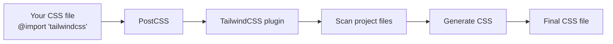
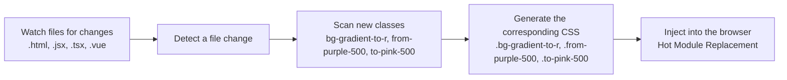
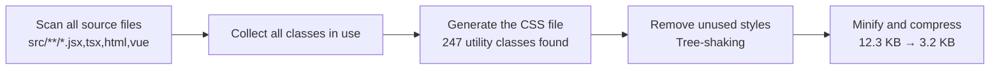
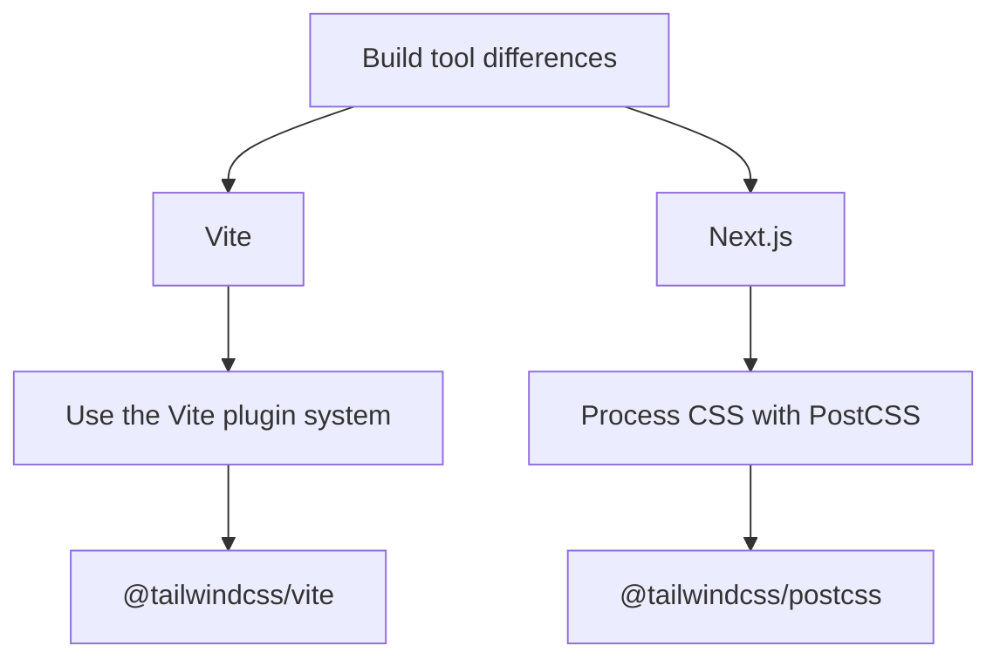

<!-- truncate -->

> This is part 2 of “TailwindCSS Fundamentals Before shadcn/ui.”
>
> **The series:**
>
> 1. [From MUI to a Utility-First Mindset](/en/blog/tailwindcss-knowledge-before-shadcn-ui-1)
> 2. **Understanding How TailwindCSS Works (this article)**
> 3. [A Quick Reference to TailwindCSS v4's Built-in Utility Classes](/en/blog/tailwindcss-knowledge-before-shadcn-ui-3)
> 4. [Customizing a Design System with @theme](/en/blog/tailwindcss-knowledge-before-shadcn-ui-4)
> 5. [Understanding shadcn/ui's Design System](/en/blog/tailwindcss-knowledge-before-shadcn-ui-5)
> 6. [The shadcn/ui Ecosystem and Toolchain](/en/blog/tailwindcss-knowledge-before-shadcn-ui-6)

## **The Core Package: tailwindcss** {#核心套件tailwindcss}

By now, you might be wondering: “A browser doesn't understand a class like `bg-blue-500`, so how does it turn into actual CSS?”

The answer lies in TailwindCSS's core package, `tailwindcss`. This is the engine responsible for:

- Parsing your HTML, JSX, and TSX files
- Scanning for the class names you use
- Generating the corresponding CSS rules

```tsx {4,6}
// TailwindCSS scans this file
function Card() {
  return (
    <div className="bg-white rounded-lg p-4 shadow-md">
      {/* TailwindCSS sees: bg-white, rounded-lg, p-4, shadow-md */}
      <h2 className="text-xl font-bold">Heading</h2>
      {/* TailwindCSS sees: text-xl, font-bold */}
    </div>
  );
}
```

TailwindCSS reads these utility class names and generates CSS according to its built-in **naming conventions**:

```css {3,8,13,18,23,29}
/* bg-white: "bg-" means background; "white" is the color value */
.bg-white {
  background-color: #fff;
}

/* rounded-lg: "rounded-" means border-radius; "lg" means large (0.5rem) */
.rounded-lg {
  border-radius: 0.5rem;
}

/* p-4: "p-" means padding on all sides; "4" means 1rem (4 × 0.25rem = 1rem) */
.p-4 {
  padding: 1rem;
}

/* shadow-md: "shadow-" means box-shadow; "md" is the default medium shadow */
.shadow-md {
  box-shadow: 0 4px 6px -1px rgba(0, 0, 0, 0.1);
}

/* text-xl: "text-" is for typography; "xl" means extra-large (1.25rem) */
.text-xl {
  font-size: 1.25rem;
  line-height: 1.75rem;
}

/* font-bold: "font-" means font-weight; "bold" maps to 700 */
.font-bold {
  font-weight: 700;
}
```

At its simplest, this conversion follows a **prefix-value** naming pattern:

- The **prefix**, such as `bg-`, `p-`, or `text-`, determines which CSS property to set.
- The **value**, such as `white`, `4`, or `xl`, determines the value of that property.

That's TailwindCSS's core job: **turn utility class names into actual CSS rules**. But how does that conversion happen? Before getting into that, we need to understand the relationship between TailwindCSS and PostCSS.

<br/>

## **How PostCSS and TailwindCSS Fit Together** {#postcss-與-tailwindcss-的關係}

What is PostCSS? Think of it as Babel for CSS.

> **Babel** converts modern JavaScript into JavaScript browsers can understand.
> **PostCSS** converts modern CSS—or special syntax—into CSS browsers can understand.

TailwindCSS is essentially a PostCSS plugin. Here's the processing pipeline:



For example:

```css {4-6}
/* src/index.css - input */
@import "tailwindcss";

@theme {
  --color-primary: oklch(0.6171 0.1375 39.0427);
}
```

After PostCSS and TailwindCSS process it:

```css {6-12}
/* Output: CSS the browser understands */
:root {
  --color-primary: oklch(0.6171 0.1375 39.0427);
}

.bg-primary {
  background-color: var(--color-primary);
}

.text-primary {
  color: var(--color-primary);
}

/* ... Other utility classes in use */
```

:::info[**@theme Namespace Rules**]
For CSS variables defined in a `@theme` block, TailwindCSS uses the **variable name's prefix** to determine which utility classes to generate:

| Variable prefix | Generated utility classes | Example |
| --------------- | ------------------------- | ------- |
| `--color-*` | Color utilities such as `.bg-*`, `.text-*`, and `.border-*` | `--color-primary` → `.bg-primary`, `.text-primary` |
| `--spacing-*` | Spacing utilities such as `.p-*`, `.m-*`, and `.gap-*` | `--spacing-lg` → `.p-lg`, `.m-lg` |
| `--font-size-*` | `.text-*` font sizes | `--font-size-huge` → `.text-huge` |
| `--radius-*` | `.rounded-*` border radii | `--radius-xl` → `.rounded-xl` |

In other words, defining `--color-primary` tells TailwindCSS that this is a color design token. It can then generate the corresponding `.xxx-primary` classes for utilities that need colors: backgrounds, text, borders, and so on.

We'll explore these rules and more examples in [Customizing a Design System with @theme](/en/blog/tailwindcss-knowledge-before-shadcn-ui-4).
:::

<br/>

## **The JIT Engine: Just-In-Time Compilation** {#jit-引擎just-in-time-編譯}

Now that we understand how PostCSS and TailwindCSS fit together, we can return to the bigger question: **with thousands of possible utility classes, how does TailwindCSS know which CSS to generate?**

TailwindCSS uses a **JIT (Just-In-Time) compilation engine**. It scans your code during development and builds, finds the classes you actually use, and generates their CSS on demand. Let's look at what happens at each stage.

### **Development: Scan and Generate on Demand** {#開發階段-development---即時掃描與生成}

In development mode, the JIT engine watches files such as `.html`, `.jsx`, `.tsx`, and `.vue` for changes. It scans new classes and generates their CSS immediately.

```tsx {4}
// You add a component during development
function NewComponent() {
  return (
    <div className="bg-gradient-to-r from-purple-500 to-pink-500">
      {/* The JIT engine detects these classes immediately */}
      Gradient background
    </div>
  );
}
```

**The JIT processing flow:**



```css {7,17,23}
/* Generated CSS */

/* bg-gradient-to-r: set the gradient direction to the right */
/* Use CSS linear-gradient; "to right" means left to right */
/* Colors come from the --tw-gradient-from and --tw-gradient-to CSS variables */
.bg-gradient-to-r {
  background-image: linear-gradient(
    to right,
    var(--tw-gradient-from),      /* Start color */
    var(--tw-gradient-to)         /* End color */
  );
}

/* from-purple-500: set the gradient start color */
/* This class only sets a CSS variable; it does not set background directly */
.from-purple-500 {
  --tw-gradient-from: #a855f7;   /* Purple */
}

/* to-pink-500: set the gradient end color */
/* Also sets only a CSS variable, used together with from-* */
.to-pink-500 {
  --tw-gradient-to: #ec4899;     /* Pink */
}
```

:::tip[**How Gradient Classes Work Together**]
These three classes show TailwindCSS's **compositional design**:

- `bg-gradient-to-r`: use a gradient running to the right.
- `from-purple-500`: start with purple.
- `to-pink-500`: end with pink.

They work together through the CSS variables `--tw-gradient-from` and `--tw-gradient-to` to produce the complete gradient. You can mix directions and colors freely without memorizing a separate class for every combination.
:::

:::tip[**What JIT Gives You**]

- **Speed**: generate only the CSS you use, rather than a complete CSS file several megabytes in size.
- **Precision**: use arbitrary values such as `w-[237px]` and `bg-[#1da1f2]`.
- **Immediate feedback**: see the result as soon as you change a class.
:::

### **Build: A Final Scan and Optimization** {#打包階段-build---最終掃描與最佳化}

At build time, the JIT engine scans all source files, collects the classes in use, and produces a minified CSS file with unused styles removed.

```bash
npm run build
```

**The JIT processing flow:**



:::warning[**Keep Class Names Static**]
The JIT engine scans only **static class names**. The following approach will leave you with missing styles:

❌ **Incorrect**: construct class names dynamically.

```tsx
// The JIT engine cannot see a complete class name: const color = 'blue';
<div className={`bg-${color}-500`}>  // ❌ Does not generate bg-blue-500
```

✅ **Correct**: use complete class names.

```tsx
// Method 1: Conditional expression
<div className={color === 'blue' ? 'bg-blue-500' : 'bg-red-500'}>

// Method 2: Object lookup: const colorMap = {
  blue: 'bg-blue-500',
  red: 'bg-red-500',
};
<div className={colorMap[color]}>
```

:::

<br/>

## **Configuring TailwindCSS in Different Environments** {#在不同環境中配置-tailwindcss}

With that background in place, let's look at configuration in real projects. Build tools such as Vite and Next.js integrate TailwindCSS differently because their **CSS processing pipelines** differ slightly.



### **Vite Configuration** {#vite-專案配置}

Vite has its own plugin system that can handle CSS transformations directly, so TailwindCSS provides a dedicated Vite plugin.

**Install the packages:**

```bash
npm install -D tailwindcss @tailwindcss/vite
```

- `tailwindcss`: the core engine.
- `@tailwindcss/vite`: the Vite plugin that integrates TailwindCSS into Vite's build pipeline.

`vite.config.ts`:

```tsx
import tailwindcss from "@tailwindcss/vite";
import { defineConfig } from "vite";

export default defineConfig({
  plugins: [
    react(),
    tailwindcss(), // Use directly as a Vite plugin
  ],
});
```

`src/index.css`:

```css
@import "tailwindcss";
```

### **Next.js Configuration** {#nextjs-專案配置}

Next.js uses PostCSS to process CSS, including its built-in CSS Modules, Autoprefixer, and CSS-in-JS support. TailwindCSS therefore integrates as a PostCSS plugin.

**Install the packages:**

```bash
npm install -D tailwindcss @tailwindcss/postcss
```

- `tailwindcss`: the core engine.
- `@tailwindcss/postcss`: the PostCSS plugin that integrates TailwindCSS into the PostCSS pipeline.

`postcss.config.mjs`:

```jsx
export default {
  plugins: {
    "@tailwindcss/postcss": {}, // Use as a PostCSS plugin
  },
};
```

`app/globals.css`:

```css
@import "tailwindcss";
```

## **Reference** {#reference}

- **[TailwindCSS Official Documentation](https://tailwindcss.com/docs)**
- **[PostCSS Documentation](https://postcss.org/)**
- **[Vite Documentation](https://vitejs.dev/)**
- **[Next.js Documentation - CSS Support](https://nextjs.org/docs/app/building-your-application/styling/css)**
- **[JIT Mode in TailwindCSS](https://tailwindcss.com/docs/just-in-time-mode)**
