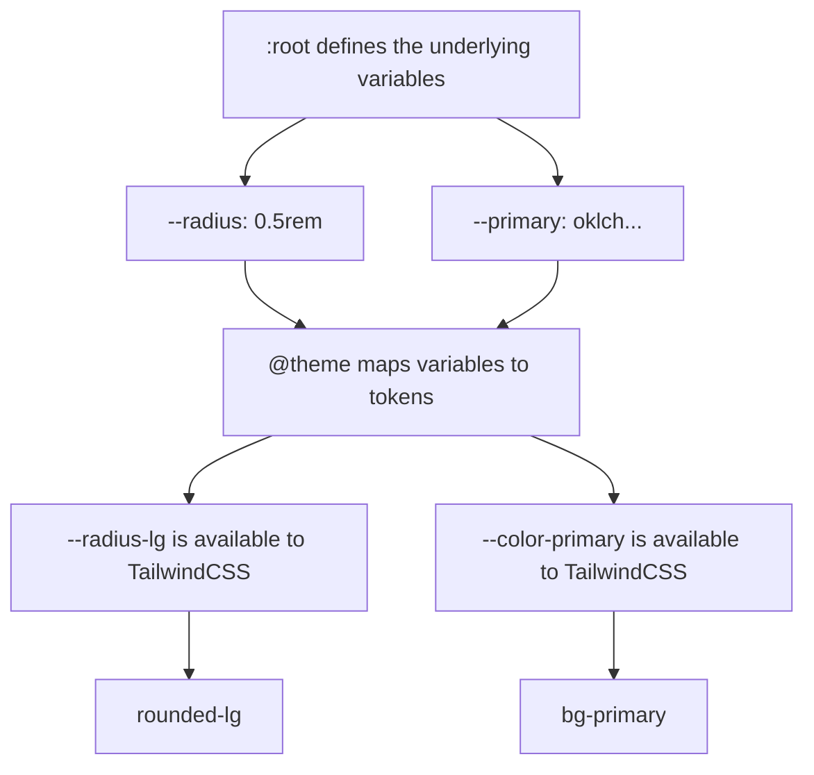
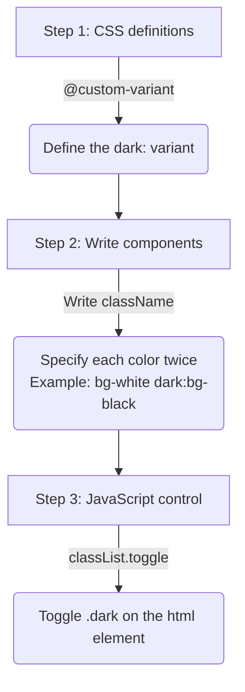
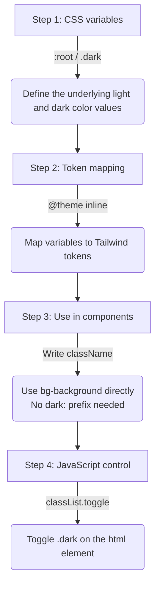

<!-- truncate -->

> This is part 5 of “TailwindCSS Fundamentals Before shadcn/ui.”
>
> **The series:**
>
> 1. [From MUI to a Utility-First Mindset](/en/blog/tailwindcss-knowledge-before-shadcn-ui-1)
> 2. [Understanding How TailwindCSS Works](/en/blog/tailwindcss-knowledge-before-shadcn-ui-2)
> 3. [A Quick Reference to TailwindCSS v4's Built-in Utility Classes](/en/blog/tailwindcss-knowledge-before-shadcn-ui-3)
> 4. [Customizing a Design System with @theme](/en/blog/tailwindcss-knowledge-before-shadcn-ui-4)
> 5. **Understanding shadcn/ui's Design System (this article)**
> 6. [The shadcn/ui Ecosystem and Toolchain](/en/blog/tailwindcss-knowledge-before-shadcn-ui-6)

When you initialize a shadcn/ui project with `npx shadcn@latest init`, it generates an `index.css` or `globals.css` file. At first glance, that file can be a little confusing:

```css
@import "tailwindcss";

@custom-variant dark (&:is(.dark *));

@theme inline {
  --color-background: var(--background);
  --color-primary: var(--primary);
  /* ... More tokens */
}

:root {
  --background: white;
  --primary: oklch(0.6171 0.1375 39.0427);
}

.dark {
  --background: #1a1a1a;
  --primary: oklch(0.8 0.15 250);
}

@layer base {
  body {
    @apply bg-background text-foreground;
  }
}
```

What exactly are `@theme inline`, `@custom-variant`, and `@layer`? How do `:root` and `.dark` make theme switching work?

In this article, we'll **walk through shadcn/ui's CSS design system piece by piece** to understand what's happening behind each line.

## **@theme: Defining Design Tokens** {#theme定義設計-token}

### **What Is a Design Token?** {#什麼是-design-token}

In the `index.css` or `globals.css` files in shadcn/ui examples, you'll often see something like this:

```css
@theme inline {
  --color-primary: var(--primary);
  --radius-lg: var(--radius);
}

:root {
  --primary: oklch(0.6171 0.1375 39.0427);
  --radius: 0.5rem;
}

.dark {
  --primary: oklch(0.8 0.15 250);
}
```

When I first started using shadcn/ui, I could roughly guess that `:root` and `.dark` defined theme variables, but I still had a few questions:

- What is `@theme inline`? It looks like theme variables too, so how is it different from `:root`?
- How do these variables turn into TailwindCSS utility classes?

These variables are **design tokens**: a shared set of values for a design system. When designing a site, you'll need to define things like:

- Primary and secondary colors
- Different spacing sizes
- Consistent border radii
- Shadows

You can define all of these as tokens and reuse them throughout the project. `@theme` is the tool TailwindCSS v4 provides to turn those tokens into utility classes.

### **Basic @theme Syntax and Usage** {#theme-的基本語法與使用方式}

Here's an example:

```css
@theme inline {
  --radius-sm: calc(var(--radius) - 4px);
  --radius-md: calc(var(--radius) - 2px);
  --radius-lg: var(--radius);
  --radius-xl: calc(var(--radius) + 4px);

  --color-primary: var(--primary);
  --color-secondary: var(--secondary);
  --color-destructive: var(--destructive);
}

:root {
  --radius: 0.5rem;
  --primary: oklch(0.6171 0.1375 39.0427);
  --secondary: oklch(0.9245 0.0138 92.9892);
}
```

What does it do?



### **How Tokens Become Utility Classes** {#token-轉換成-utility-class-的規則}

In the example above, defining `--color-primary` lets us use `bg-primary` in React or HTML. There's a specific naming convention behind that conversion.

:::tip
For details on each token type, see the [TailwindCSS v4 theme documentation](https://tailwindcss.com/docs/v4-beta#theme) and part 4 of this series: [Customizing a Design System with @theme](/en/blog/tailwindcss-knowledge-before-shadcn-ui-4).
:::

**Rule 1: Remove the type prefix**

When a token becomes a utility class, its type prefix—such as `--color-`, `--spacing-`, or `--radius-`—is removed, leaving its semantic name.

**Rule 2: Combine it with a property prefix**

Different CSS properties have different TailwindCSS prefixes:

| Token type | Definition | Usage |
| ---------- | ---------- | ----- |
| Color | `--color-brand` | `bg-brand`, `text-brand`, `border-brand` |
| Spacing | `--spacing-lg` | `p-lg`, `m-lg`, `gap-lg` |
| Border radius | `--radius-card` | `rounded-card` |
| Width | `--width-sidebar` | `w-sidebar`, `min-w-sidebar` |
| Height | `--height-header` | `h-header`, `max-h-header` |
| Font family | `--font-family-heading` | `font-heading` |
| Font size | `--font-size-xl` | `text-xl` |
| Font weight | `--font-weight-bold` | `font-bold` |
| Shadow | `--shadow-card` | `shadow-card` |
| Opacity | `--opacity-soft` | `opacity-soft` |

**An example in practice:**

```css
/* Define in index.css */
@theme inline {
  --color-brand: #ff6b6b;
  --spacing-card: 1.5rem;
  --radius-button: 0.375rem;
  --font-family-heading: "Inter", sans-serif;
  --font-size-xl: 1.25rem;
  --shadow-elevated: 0 4px 6px rgba(0, 0, 0, 0.1);
  --width-sidebar: 16rem;
}
```

```tsx
// Use in React/HTML
function Card() {
  return (
    <div
      className="
      bg-brand              {/* --color-brand */}
      p-card                {/* --spacing-card */}
      rounded-button        {/* --radius-button */}
      shadow-elevated       {/* --shadow-elevated */}
      w-sidebar             {/* --width-sidebar */}
    "
    >
      <h1 className="font-heading text-xl">
        {" "}
        {/* --font-family-heading, --font-size-xl */}
        Heading
      </h1>
    </div>
  );
}
```

:::info[The Naming Difference for Border Radii]

Border radii have a particular naming detail: the token uses `--radius-`, but the utility class uses `rounded-`:

- `--radius-lg` → `rounded-lg`: `radius` in the token, `rounded` in the utility.
- `--radius-button` → `rounded-button`

Compare that with a color token:

- `--color-primary` → `bg-primary`: both concern color.
:::

<br/>

## **@theme inline: What inline Does** {#theme-inlineinline-關鍵字的作用}

The examples so far have used `@theme inline` rather than plain `@theme`. The difference is whether the dynamic behavior of CSS variables is preserved. That matters directly for features such as dark mode, as we'll see later in “Method 2: Semantic Colors.”

### **inline Keeps Values Dynamic** {#inline-關鍵字的作用保留動態特性}

The `inline` keyword tells Tailwind that these theme values are dynamic: they should be resolved by the browser at runtime through references to other CSS variables, rather than fixed at build time.

Let's look at an example.

**Without `inline`:**

```css
/* Definition */
@theme {
  --color-primary: var(--primary);
}

:root {
  --primary: oklch(0.6171 0.1375 39.0427);
}

.dark {
  --primary: oklch(0.8 0.15 250);
}
```

TailwindCSS generates:

```css
:root {
  --color-primary: var(--primary); /* Generated global variable */
}

.bg-primary {
  background-color: var(
    --color-primary
  ); /* The utility uses --color-primary defined above */
}
```

The problem is that `--color-primary` is resolved at the `:root` level. If a nested `.dark` selector changes `--primary`—we'll cover how `.dark` works shortly—`--color-primary` may not pick up that change, leaving `bg-primary` with the old value.

**With `inline`:**

```css
/* Definition */
@theme inline {
  --color-primary: var(--primary);
}

:root {
  --primary: oklch(0.6171 0.1375 39.0427);
}

.dark {
  --primary: oklch(0.8 0.15 250);
}
```

TailwindCSS skips the intermediate `--color-primary` variable and makes the utility class reference your semantic variable directly:

```css
.bg-primary {
  background-color: var(
    --primary
  ); /* Reference --primary directly, without an intermediate --color-primary */
}
```

Now, wherever `--primary` changes—inside `.dark`, `[data-theme="..."]`, or even a particular component container—`bg-primary` reflects the current color correctly.

<br/>

## **Light and Dark Themes, Method 1: The dark: Prefix** {#實作亮暗主題---方法一使用-dark-前綴}

With `@theme inline` covered, let's look at a complete light and dark theme switch.

There are **two main approaches** in TailwindCSS:

1. **Use the `dark:` prefix**: specify each style twice.
2. **Use semantic colors**: colors adapt automatically; this is the recommended approach.

We'll start with **method 1**, where you explicitly specify both the light and dark versions of each style.

**Usage:**

```html
<div class="bg-white dark:bg-gray-800 text-gray-900 dark:text-white">
  Specify each style twice
</div>
```

The key is the `dark:` prefix, called a **variant**. It works like a condition: apply the following style only when the `dark` condition is met.

:::info[Common Variants]

- `hover:` applies while the pointer is hovering over the element.
- `focus:` applies when the element has focus.
- `dark:` applies under the `.dark` theme.
:::

> So what exactly is this `dark` condition? That's something we need to define.

### **Define the dark: Variant with @custom-variant** {#用-custom-variant-定義-dark-變體}

Tailwind v4 provides `@custom-variant` for defining your own variants. Add this line to your CSS to define `dark:`:

```css
@custom-variant dark (&:is(.dark *)); /* shadcn default definition */
```

Let's break it into three parts:

1. **`@custom-variant`** tells Tailwind we're defining a new variant.
2. **`dark`** is its name. Naming it `dark` lets us use `dark:`. If we called it `night-mode`, we'd write `night-mode:bg-primary` instead.
3. **`(&:is(.dark *))`** is the condition, expressed as a CSS selector. In plain English: this element (`&`) must be inside an ancestor with the `.dark` class.

### **How It Compiles** {#背後的編譯原理}

When you write `dark:bg-foreground dark:text-background`, the compilation works like this:

**1. Tailwind compiles the base utility classes**

For `bg-background text-foreground`, Tailwind generates the basic utility classes based on your `@theme` configuration:

```css
.bg-background {
  background-color: var(--color-background);
}
.text-foreground {
  color: var(--color-foreground);
}
```

**2. Tailwind compiles the dark: variant**

For `dark:bg-foreground dark:text-background`, Tailwind looks up the variant named `dark`. It finds the `(&:is(.dark *))` rule defined with `@custom-variant` and combines that rule with the utility class to generate a conditional class:

```css
/* Expanded dark variant: equivalent to a .dark ancestor selector */
.dark .dark\:bg-foreground {
  background-color: var(--color-foreground);
}
.dark .dark\:text-background {
  color: var(--color-background);
}
```

The selector `.dark .dark\:bg-foreground` means the style applies only when an element has the `dark:bg-foreground` class **and** is a descendant of an element with `.dark`.

:::info[Why &:is(.dark *) Rather Than .dark &?]
`&:is(.dark *)` lets `.dark` take effect at **any ancestor level**, rather than only on the immediate parent. Whether `.dark` is on `<html>` or `<body>`, deeply nested children can receive the dark styles.
:::

### **Controlling Light and Dark Themes in React** {#在-react-中控制亮暗主題}

For `dark:` styles to apply, the element must be a descendant of `.dark`. The usual approach is to **toggle `.dark` on the `<html>` element**. Everything on the page then becomes its descendant, so all `dark:` styles take effect together:

```tsx
import { useState, useEffect } from "react";

export default function App() {
  const [dark, setDark] = useState(false);

  useEffect(() => {
    // Toggle the .dark class on <html>
    // Enable or disable all dark: styles together
    document.documentElement.classList.toggle("dark", dark);
  }, [dark]);

  return (
    <div className="min-h-screen grid place-items-center">
      <button
        className="px-4 py-2 rounded-md bg-white dark:bg-gray-800 text-gray-900 dark:text-white"
        onClick={() => setDark((d) => !d)}
      >
        Switch to {dark ? "Light" : "Dark"}
      </button>
    </div>
  );
}
```

**The complete flow:**



<br/>

## **Light and Dark Themes, Method 2: Semantic Colors (Recommended)** {#實作亮暗主題---方法二使用語意化顏色推薦}

This is the approach shadcn/ui uses. It puts the division of responsibilities between `@theme inline` and `:root`/`.dark` into practice. Define each style once, and its colors adapt to the theme.

### **How Switching Works: Overriding CSS Variables** {#切換機制css-變數的覆蓋原理}

The core mechanism is **overriding CSS variables**:

- When an element has **no** `.dark` ancestor, the browser uses the values defined in `:root`.
- When it **has** a `.dark` ancestor, the values defined in `.dark` override those from `:root`.

This diagram shows how that works:


### **Configuration** {#設定方式}

```css
/* index.css */
@theme inline {
  --color-background: var(--background);
  --color-foreground: var(--foreground);
}

:root {
  --background: white; /* Light-mode background color */
  --foreground: black; /* Light-mode text color */
}

.dark {
  --background: #1a1a1a; /* Dark-mode background color */
  --foreground: white; /* Dark-mode text color */
}
```

**Usage:**

```tsx
<div className="bg-background text-foreground">
  Adapts to light and dark themes without a dark: prefix
</div>
```

The automatic switch comes down to three things:

1. `bg-background` compiles to `background-color: var(--background)`.
2. Without `.dark` on `<html>`, `--background` uses the `white` value defined in `:root`.
3. With `.dark` on `<html>`, the `#1a1a1a` value in `.dark` overrides the value from `:root`.

### **The Roles of @theme inline and :root/.dark** {#theme-inline-與-dark-的分工}

In this design, tokens are defined in two layers.

**Layer 1: `:root` and `.dark` define the underlying values**

```css
:root {
  --background: white; /* Light-mode background color */
  --foreground: black; /* Light-mode text color */
}

.dark {
  --background: #1a1a1a; /* Dark-mode background color */
  --foreground: white; /* Dark-mode text color */
}
```

These are **CSS variables**, used in CSS through expressions such as `var(--background)`. They **can't be used directly as TailwindCSS classes**.

**Layer 2: `@theme inline` maps those values to TailwindCSS tokens**

```css
@theme inline {
  --color-background: var(--background); /* Map --background to a token TailwindCSS can use */
  --color-foreground: var(--foreground);
}
```

These are **TailwindCSS tokens**, available through utility classes:

```tsx
// ✅ Use this: bg-background generates background-color: var(--background)
<div className="bg-background text-foreground">

// ❌ Technically possible, but not recommended
// TailwindCSS cannot track this variable or provide IDE autocomplete for it
<div className="bg-[var(--background)]">
```

This separation lets you:

1. **Switch theme values in `:root` and `.dark`**, for example for dark mode.
2. **Define TailwindCSS tokens in `@theme inline`.**
3. **Have the tokens reflect theme value changes automatically.**

:::tip[inline Is the Key]
With `@theme inline`, TailwindCSS preserves the dynamic behavior of CSS variables. Utilities reference `var(--background)` directly instead of a fixed value, so when `.dark` overrides the variable, the utilities pick up the new value.
:::

### **Controlling the Theme in React** {#在-react-中控制主題}

As with method 1, you control the theme by toggling `.dark` on `<html>`. The difference is that **you don't need a `dark:` prefix for every style**. The CSS variables switch automatically based on whether `.dark` is present:

```tsx
import { useState, useEffect } from "react";

export default function App() {
  const [dark, setDark] = useState(false);

  useEffect(() => {
    document.documentElement.classList.toggle("dark", dark);
  }, [dark]);

  return (
    <div className="min-h-screen grid place-items-center">
      <button
        className="px-4 py-2 rounded-md bg-primary text-primary-foreground"
        onClick={() => setDark((d) => !d)}
      >
        Switch to {dark ? "Light" : "Dark"}
      </button>
    </div>
  );
}
```

**The complete flow:**



### **Comparing the Two Approaches** {#兩種方法的對比}

| | Method 1: `dark:` Prefix | Method 2: Semantic Colors (Recommended) |
| - | --------------------- | -------------------------------------- |
| **Syntax** | Specify each style twice | Specify each style once |
| **Maintenance** | Changes require edits in multiple places | Change the CSS variables |
| **Code volume** | More | Less |
| **Use case** | One-off overrides and special cases | A consistent theme system |
| **shadcn/ui** | ❌ Not its main approach | ✅ Used by default |

```tsx
// ❌ Method 1: specify every color twice
<div className="bg-white dark:bg-gray-900 text-black dark:text-white border-gray-200 dark:border-gray-700">
  Content
</div>

// ✅ Method 2: semantic colors keep things concise and maintainable
<div className="bg-background text-foreground border-border">
  Content
</div>
```

<br/>

## **@layer: Organizing Styles** {#layer組織樣式}

`@layer` lets you organize custom CSS and control style precedence.

### **TailwindCSS's Three Layers** {#tailwindcss-的三個層級}

TailwindCSS divides CSS into three layers:

```css
@layer base {
  /* Base styles: resets and defaults */
}

@layer components {
  /* Component styles: reusable component classes */
}

@layer utilities {
  /* Utility styles: single-purpose utility classes */
}
```

**Layer precedence:**

```
utilities > components > base
```

### **A Practical Example: @layer base** {#實務範例layer-base-的應用}

```css
@layer base {
  * {
    @apply border-border outline-ring/50;
  }
  body {
    @apply bg-background text-foreground;
  }
}
```

What does this do?

1. For **all elements (`*`)**:
   - Use `border-border` as the default border color.
   - Use `outline-ring/50` as the default outline color, at 50% opacity.
2. For the **body**:
   - Use `bg-background` for the background.
   - Use `text-foreground` for text.

**The @apply directive:**

`@apply` lets you use TailwindCSS utilities inside CSS:

```css
.my-button {
  @apply bg-blue-500 text-white px-4 py-2 rounded hover:bg-blue-600;
}
```

### **When Should You Use @layer?** {#什麼時候使用-layer}

Choose a layer based on **what you're trying to change**.

**@layer base: Change the Default Styles of HTML Elements**

**Use it when** you want to change the default appearance of **HTML elements themselves**, such as every `<h1>`, `<a>`, or `<body>`.

**Characteristics:**

- Targets HTML tags such as `h1`, `body`, and `a`
- Applies globally across the site
- Usually configured near the start of a project and rarely changed afterward

**Example:**

```css
@layer base {
  /* Set the default styles for all h1 elements */
  h1 {
    @apply text-4xl font-bold;
  }

  /* Set the default styles for all links */
  a {
    @apply text-blue-500 hover:underline;
  }

  /* Set default border and outline styles for all elements */
  * {
    @apply border-border outline-ring/50;
  }
}
```

**The result:** writing `<h1>Title</h1>` in HTML automatically applies `text-4xl font-bold`, with no extra classes required.

---

**@layer components: Create Reusable Component Classes**

**Use it when** you have a group of styles reused in several places that represents a component, such as a button or card.

**Characteristics:**

- Targets custom class names such as `.btn-primary` and `.card`
- Applies only when you add the class in HTML
- Often used for components in a design system

**Example:**

```css
@layer components {
  .btn-primary {
    @apply bg-blue-500 text-white px-4 py-2 rounded hover:bg-blue-600;
  }

  .card {
    @apply bg-white rounded-lg shadow-md p-6;
  }
}
```

**Usage:**

```html
<button class="btn-primary">Button</button>
<div class="card">Card content</div>
```

:::warning[Use in Moderation]
In modern TailwindCSS projects, **overusing @layer components is generally discouraged**, because it loses the benefits of utility-first styling. A better approach is to compose utilities directly in React or Vue components, or use CVA, which we'll cover in the next article.
:::

---

**@layer utilities: Create Custom Utility Classes**

**Use it when** the built-in utilities don't cover what you need and you want to add a class with a single purpose.

**Characteristics:**

- Targets custom utilities such as `.text-balance` and `.scrollbar-hide`
- Each class does one thing
- Extends TailwindCSS's utility classes

**Example:**

```css
@layer utilities {
  /* Add balanced text wrapping */
  .text-balance {
    text-wrap: balance;
  }

  /* Add a utility to hide scrollbars */
  .scrollbar-hide {
    -ms-overflow-style: none;
    scrollbar-width: none;
  }

  .scrollbar-hide::-webkit-scrollbar {
    display: none;
  }
}
```

**Usage:**

```html
<h1 class="text-balance">This heading uses balanced text wrapping</h1>
<div class="overflow-auto scrollbar-hide">Scrollable area with hidden scrollbars</div>
```

---

**A Quick Decision Table**

| I want to... | Layer | Example |
| ------------ | ----- | ------- |
| Change the default style of every `<h1>` | `@layer base` | `h1 { @apply text-4xl; }` |
| Create a button component class | `@layer components` | `.btn { @apply px-4 py-2; }` |
| Add a utility, such as hiding the scrollbar | `@layer utilities` | `.scrollbar-hide { ... }` |
| Compose styles in a React component | **Use utility classes directly, without @layer** | `<div className="px-4 py-2 bg-blue-500">` |

<br/>

## **Reference** {#reference}

- [**TailwindCSS v4 Beta Documentation**](https://tailwindcss.com/docs/v4-beta)
- [**Theme Configuration - @theme**](https://tailwindcss.com/docs/v4-beta#theme)
- [**Custom Variants - @custom-variant**](https://tailwindcss.com/docs/v4-beta#custom-variants)
- [**Layers - @layer**](https://tailwindcss.com/docs/v4-beta#layers)
- [**Dark Mode**](https://tailwindcss.com/docs/dark-mode)
