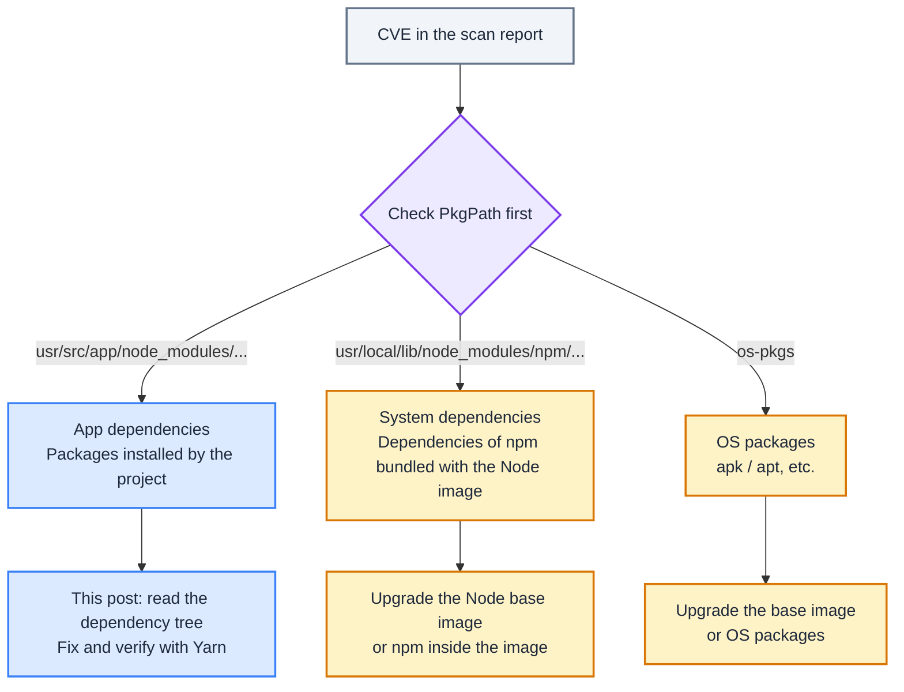
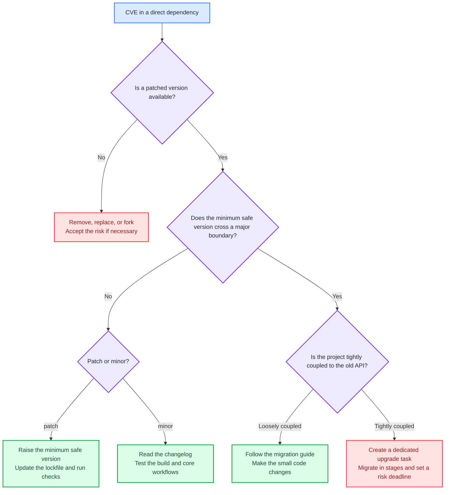
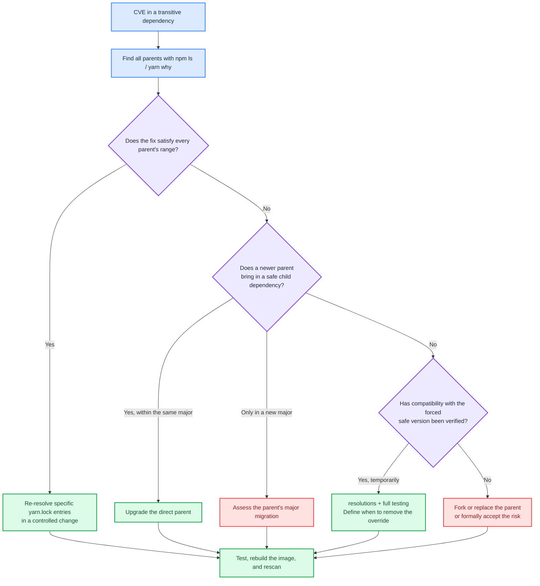

I've been fixing quite a few package CVEs in Node.js projects at work lately, so I wanted to write down the decision process while it's still fresh. The first time I saw CVEs, Fixed Version fields, and long `node_modules` paths in a scan report, all I knew was “some packages need upgrading.” I had no idea how to go about it. For the first few fixes, I kept looking things up and asking AI for help. After working through several dependency setups, I started to see the pattern: **fixing Node.js package vulnerabilities means reading the dependency tree, checking version ranges, and choosing the smallest safe change.** The options differ considerably depending on whether the vulnerable package is a direct dependency, a transitive dependency, pinned to an exact version, or no longer maintained. I'll walk through the situations I've encountered and worked through, so you can see the reasoning behind each decision.

<!-- truncate -->

:::note Package manager used in this post
This post focuses on projects using **Yarn Classic (Yarn 1)**. Fixes involve editing `package.json` and `yarn.lock`, then using Yarn to install or upgrade packages. Yarn Berry, npm-only projects, and pnpm each have their own lockfiles and override mechanisms. Don't mix the Yarn commands here into those workflows as-is.
:::

<br/>

## **The First Decision in a Scan Report: Identify the Source** {#弱掃報告的第一個分岔區分漏洞來源}

As I mentioned in [Finding Security Vulnerabilities Earlier in Development with Trivy](2026-02-24-如何使用%20Trivy%20在開發階段提前發現安全漏洞.md), mainstream vulnerability scanners generally detect both **OS packages (`os-pkgs`)** and **language ecosystem packages (`lang-pkgs`)**.

For language packages:

- If `PkgPath` looks like `usr/src/app/node_modules/axios/package.json`, the package was installed through the project's `package.json` and lockfile. You can usually fix this by upgrading project dependencies, adjusting resolved versions, or replacing a parent package. This is what the post focuses on.
- By contrast, `usr/local/lib/node_modules/npm/node_modules/...` usually belongs to npm itself, which comes with the Node.js base image. The scanner can find these packages in the image even if your project doesn't use them. Changing `package.json` won't help. Instead, check whether a patched Node base image is available, or upgrade npm inside the image according to your team's policies.



<br/>

## **Understanding the Project's Dependencies** {#理解專案的依賴關係}

Once I've confirmed that the vulnerability belongs to the application's dependencies, the first thing I do is locate it in the dependency tree. It might be a package the project installs directly, or one brought in by a direct dependency.

### **Direct and Transitive Dependencies** {#直接依賴與間接依賴}

Suppose the root `package.json` contains only this declaration:

```json title="package.json"
{
  "dependencies": {
    "react-router-dom": "^6.30.2"
  }
}
```

`react-router-dom` is a **direct dependency** because it's listed in the root `package.json`. The `react-router` and `@remix-run/router` packages it installs are **transitive dependencies**. After installation, the logical relationships look like this:

```text
my-app
└─ react-router-dom@6.30.2                 # Direct dependency
   ├─ @remix-run/router@1.23.1             # Transitive dependency
   └─ react-router@6.30.2
      └─ @remix-run/router@1.23.1 (deduped)
```

`deduped` means the two paths share one installed copy of the package, rather than installing a second copy of `@remix-run/router`. There are still two logical dependency paths, though. When multiple parents are involved later, we need to check both.

### **Reading `yarn.lock`** {#解讀-yarnlock}

One thing that often trips up beginners is treating a version declaration in `package.json`, such as `6.30.2`, as “the currently installed version.” What the manifest declares is the acceptable **version range**. On the first install, Yarn selects a version within that range and records the result in `yarn.lock`. The field we actually need to compare with the scan report is the lockfile's `version`:


```text title="yarn.lock"
react-router-dom@^6.30.2:
  version "6.30.2"
  resolved "https://registry.yarnpkg.com/react-router-dom/-/react-router-dom-6.30.2.tgz"
  dependencies:
    "@remix-run/router" "1.23.1"
    react-router "6.30.2"
```

The first line of a lockfile entry identifies the version range being resolved. `version` is the version actually selected for this installation. The parent's `dependencies` block records the ranges it allows or requires for its child packages. Here's a fictional example we'll use throughout the post:

```text title="yarn.lock"
package-a@^1.1.0:
  version "1.1.0"
  dependencies:
    vulnerable-lib "^1.0.0"

vulnerable-lib@^1.0.0:
  version "1.0.3"
```

This means `package-a` allows any version of `vulnerable-lib` from `1.0.0` up to, but excluding, `2.0.0`. Yarn can therefore resolve it to `1.0.9`. If the declaration were the exact version `"1.0.3"`, moving to `1.0.9` wouldn't be an upgrade within the allowed range. That's a constraint we need to check before fixing a transitive dependency.

:::note A quick reminder about version ranges

- `^1.0.0` means `>= 1.0.0` and `< 2.0.0`.
- `~1.0.0` means `>= 1.0.0` and `< 1.1.0`.
- `1.0.3` accepts only `1.0.3` itself.
:::

<br/>

## **Commands I Use to Investigate Vulnerabilities and Dependencies** {#追查弱點與依賴關係時會用的指令}

With the dependency tree and lockfile in mind, we need a few more facts: which version is safe, what currently brings the package in, what range the parent allows, and whether a newer parent already includes the fix. I still use npm for queries in Yarn Classic projects because the tree output from `npm ls` is easy to read. These are read-only queries; they don't change `package.json` or `yarn.lock`.

### **Start with `yarn audit` to Find the Vulnerability and Minimum Patched Version** {#先用-yarn-audit-確認弱點與修補下限}

If I'm investigating from the project itself, I start with:

```bash
yarn audit
```

The output changes as the vulnerability database changes. In practice, I mainly look at `Package`, `Patched in`, `Dependency of`, and `Path`:

```text
┌───────────────┬────────────────────────────────────┐
│ Package       │ vulnerable-lib                     │
│ Patched in    │ >= 1.0.9                           │
│ Dependency of │ package-a                          │
│ Path          │ package-a > vulnerable-lib         │
└───────────────┴────────────────────────────────────┘
```

For an image scan, I use the report's `PkgName`, `InstalledVersion`, `FixedVersion`, and `PkgPath` to establish the same facts. Either way, this step only tells us which version is vulnerable and the minimum safe version. It doesn't yet tell us which package to change.

### **Use `npm ls` to Find the Current Parents** {#用-npm-ls-找到目前的父層}

Next, I look up every path to the vulnerable package in the current installation. Take `@remix-run/router@1.23.1` as an example:

```bash
npm ls @remix-run/router
```

```text
my-app@1.0.0 /path/to/my-app
└─┬ react-router-dom@6.30.2
  ├── @remix-run/router@1.23.1
  └─┬ react-router@6.30.2
    └── @remix-run/router@1.23.1 deduped
```

This rules out the instinctive approach of “just upgrade `@remix-run/router`.” The root project directly installs `react-router-dom`; `@remix-run/router` is a transitive dependency it brings in. The `deduped` marker also helps us see whether the same vulnerability enters the project through more than one path.

### **Use `npm info` to Check the Parent's Ranges and Available Upgrades** {#用-npm-info-看父層的版本範圍與可升級版本}

Once I know the parent, I check exactly how its currently installed version declares the child:

```bash
npm info react-router-dom@6.30.2 dependencies
```

```text
{
  '@remix-run/router': '1.23.1',
  'react-router': '6.30.2'
}
```

`1.23.1` is an exact version. Yarn can't float it to `1.23.2`. So even if the scan calls for `@remix-run/router >= 1.23.2`, deleting its lockfile entry won't fix the problem. We need to check for a newer parent:

```bash
npm info react-router-dom versions
```

```text
[
  ...,
  '6.30.1',
  '6.30.2',
  '6.30.3',
  ...
]
```

Finally, I check the candidate version's dependencies:

```bash
npm info react-router-dom@6.30.3 dependencies
```

```text
{
  '@remix-run/router': '1.23.2',
  'react-router': '6.30.3'
}
```

Now we can identify `react-router-dom@6.30.3` as the upgrade that brings in the fix, rather than forcing an override on `@remix-run/router`. Each transitive dependency case below follows these same four questions.

<br/>

## **Fixing Vulnerabilities in Direct Dependencies** {#直接依賴安全漏洞的修復策略}

If the vulnerable package is already listed in the root `package.json`, it's usually easier to trace and fix. The decision process below breaks down into five situations:



### **Case 1: A Patch Upgrade Is Enough** {#案例一patch-升級即可修復}

Suppose the root `package.json` declares `"http-client": "^1.6.0"`, and the scanner requires `http-client >= 1.6.8`. `http-client` is a direct dependency, and `1.6.8` is still within `^1.6.0`. This is the simplest case.

I'd explicitly raise the minimum acceptable version:

```bash
yarn upgrade http-client@^1.6.8
```

### **Case 2: A Minor Upgrade Fixes It, but Could Hide a Breaking Change** {#案例二minor-升級能修但可能有隱性-breaking-change}

Suppose the root `package.json` has `build-helper@3.1.0`, and the fix is in `3.4.0`. In theory, a package following **SemVer** shouldn't break existing APIs in a minor release. In practice, the npm ecosystem isn't always that reliable. Build tools, bundlers, lint plugins, and framework plugins in particular may change defaults, output formats, or peer dependency requirements.

I'd still start by upgrading the package as a minor update:

```bash
yarn upgrade build-helper@^3.4.0
```

But I'd also:

- Read the changelog and release notes.
- Run unit tests, the build, lint, and end-to-end tests.
- Specifically test the core workflow that depends most heavily on the tool.

### **Case 3: A Major Upgrade Is Required, but the Project Uses Only a Few APIs** {#案例三需要-major-升級但專案只用到少量-api}

Suppose the root `package.json` has `report-kit@1.x`, and only `2.0.0` fixes the vulnerability. The project happens to use just a few of its APIs, so the upgrade requires only a small amount of code to change.

The usual approach is to upgrade the major version first:

```bash
yarn upgrade report-kit@^2.0.0
```

Then:

- Update the code according to the migration guide.
- Add tests for the changes and confirm that the generated reports still meet requirements.
- Specifically test the core workflow that relies most heavily on the tool.

### **Case 4: A Major Upgrade Is Required, but the Project Is Tightly Coupled to the Old Version** {#案例四需要-major-升級但專案深度綁定舊版}

Now suppose the root `package.json` has `legacy-bundler@4.x`, and fixing it requires `5.x`. But the project's loaders, plugins, CI configuration, and deployment artifacts are all tightly tied to v4. “Upgrading one package” has become a migration of the build process.

I'd turn this from a routine vulnerability fix into a dedicated upgrade task:

- Identify the breaking changes and every place the package is used.
- Create a separate branch.
- Centralize usage behind wrappers.
- Upgrade the major version and adapt the code step by step.
- Add the necessary tests and deployment checks.
- Test and merge in stages.

If the customer's release schedule doesn't allow us to finish it all at once, we'd usually:

- Document the conditions needed to exploit the vulnerability.
- Confirm the compensating controls already in place.
- Set an expiration date for accepting the risk.
- Schedule the upgrade as a formal task.

> If the vulnerability only affects a CLI build tool that never runs in production, accepting the risk temporarily may be reasonable. But if the package handles external input on a production server, leaving it unresolved for a long time is a different matter.

### **Case 5: The Package Is Unmaintained and Has No Fix** {#案例五套件停止維護而且沒有修補版本}

Suppose `old-excel-reader@0.18.5` hasn't been maintained in years, and the scanner provides no Fixed Version. The biggest problem here isn't that upgrading is difficult. There's simply no upgrade to make.

I usually evaluate the options in this order:

- Check whether the functionality is still used. Remove it if possible.
- If it can't be removed, look for an actively maintained replacement.
- Consider forking and patching it ourselves only if replacement would be too costly.
- If temporarily accepting the risk is the only option, document at least whether the vulnerability is exposed to external input, whether it runs in production, what compensating controls exist, and when we'll reassess it.

<br/>

## **Fixing Vulnerabilities in Transitive Dependencies** {#間接依賴安全漏洞的修復策略}

For direct dependencies, we can start with the root `package.json`. Transitive dependencies add another constraint: the compatibility range declared by the parent. This was the part I initially found most complicated, but it turned out to follow the clearest pattern. To keep installed versions separate from declared ranges, the version numbers in the trees below are the currently installed versions. The comments at the end of each line show the parent's declared range.



### **Case 1: The Fix Is Within the Parent's Allowed Range** {#案例一修補版仍在父層允許範圍內}

Suppose the current dependency tree looks like this. The scan reports a vulnerability in `vulnerable-lib@1.0.3` and requires at least `1.0.9`:

```text
my-app
└─ package-a@1.1.0
   └─ vulnerable-lib@1.0.3   # package-a declares: ^1.0.0
```

`^1.0.0` allows `1.0.9`, so the parent itself doesn't need an update. The lockfile is simply holding on to an old resolution.

The Yarn Classic lockfile entry might look like this:

```text title="yarn.lock"
vulnerable-lib@^1.0.0:
  version "1.0.3"
  resolved "https://registry.yarnpkg.com/vulnerable-lib/-/vulnerable-lib-1.0.3.tgz"
  integrity sha512-...
```

After confirming that **every version range referencing this entry accepts the safe version**, I'd remove just this complete entry in a separate commit, then run:

```bash
yarn install
```


When `yarn install` finds no lockfile resolution for that range, it selects a version from the registry that satisfies `^1.0.0`. If the latest safe version available is `1.0.9`, Yarn writes the entry back as:

```diff title="yarn.lock"
 vulnerable-lib@^1.0.0:
-  version "1.0.3"
-  resolved "https://registry.yarnpkg.com/vulnerable-lib/-/vulnerable-lib-1.0.3.tgz"
-  integrity sha512-...
+  version "1.0.9"
+  resolved "https://registry.yarnpkg.com/vulnerable-lib/-/vulnerable-lib-1.0.9.tgz"
+  integrity sha512-...
```

The entry's key is still `vulnerable-lib@^1.0.0`, because the parent's requirement hasn't changed. What changed is the actual version Yarn selected within that range. After reinstalling, I'd run `npm ls vulnerable-lib` again to confirm that it really shows `1.0.9`.

:::warning Don't delete the entire `yarn.lock`
Deleting the whole lockfile and reinstalling re-resolves every dependency that can float. That creates a huge diff and makes it hard to tell which change fixed the vulnerability. Here, the goal is only to update one resolution we've confirmed can move safely.

Don't use `--frozen-lockfile` for this re-resolution: its purpose is to prevent lockfile updates. Once the safe version is recorded and checked, CI should continue using `--frozen-lockfile` for reproducible installs.
:::

### **Case 2: The Old Parent Excludes the Fix, but a Newer Parent in the Same Major Supports It** {#案例二修補版不被舊父層允許但同-major-父層已有新版}

Suppose the installed `package-a@1.1.4` only allows `vulnerable-lib` v1. Every `1.x` version is vulnerable, and the first safe version is `2.0.0`:

```text
my-app
└─ package-a@1.1.4
   └─ vulnerable-lib@1.0.3   # package-a declares: ^1.0.0
```

Upgrading the child directly to v2 crosses the parent's compatibility boundary.

But checking the newer parent reveals that `package-a@1.2.0` now declares `vulnerable-lib@^2.0.0`. The package to upgrade is the parent:

```bash
npm info package-a@1.1.4 dependencies
npm info package-a@1.2.0 dependencies
yarn upgrade package-a@^1.2.0
```

The resulting tree becomes:

```text
my-app
└─ package-a@1.2.0
   └─ vulnerable-lib@2.0.0   # package-a declares: ^2.0.0
```

Because the new `package-a` has updated its own dependency range, it naturally brings in the patched `vulnerable-lib`. Our project only needs to verify whether the minor upgrade of `package-a` affects how we use it.

### **Case 3: Only a Major Upgrade of the Parent Brings in a Safe Child** {#案例三父層必須-major-upgrade-才能帶入安全子依賴}

If every `package-a@1.x` depends on `vulnerable-lib@1.x`, and only `package-a@2.x` switches to v2, the relationship looks like this:

```text
my-app
└─ package-a@1.8.0
   └─ vulnerable-lib@1.0.3   # package-a declares: ^1.0.0

Target after remediation
my-app
└─ package-a@2.0.0
   └─ vulnerable-lib@2.0.0   # package-a declares: ^2.0.0
```

This takes us back to case 3 or 4 under major upgrades of direct dependencies. We're still upgrading the root project's direct dependency, `package-a`; the reason is to replace its child dependency.

### **Case 4: The Parent Hasn't Released an Update, and `resolutions` Is a Reasonable Temporary Fix** {#案例四父層久未發布新版但-resolutions-是合理的暫時修補}

Suppose the parent pins `vulnerable-lib` to exactly `1.0.3`, rather than allowing a floating range:

```text
my-app
└─ package-a@1.1.4
   └─ vulnerable-lib@1.0.3   # package-a declares: 1.0.3
```

The advisory identifies `1.0.9` as a patch release with the same API, but upstream hasn't released an update. The team has also verified in an isolated environment that `package-a` works with `1.0.9`: the core functionality, tests, and build all pass. This is when I'd consider Yarn Classic's `resolutions`:

```json title="package.json"
{
  "resolutions": {
    "package-a/vulnerable-lib": "1.0.9"
  }
}
```

Then run `yarn install` and confirm that both the lockfile and `npm ls vulnerable-lib` reflect the specified version.

:::info When to use resolutions
`resolutions` lets the root project override specific child dependency versions during dependency tree resolution. The [Yarn documentation](https://classic.yarnpkg.com/en/docs/selective-version-resolutions/) lists an important security update that upstream hasn't adopted yet as a typical use case.

But I treat it as **a compatibility assumption with an expiration date**. Keep the relevant tests, track whether `package-a` releases an official fix, and remove the override after upgrading the parent. It doesn't replace upgrading direct dependencies, and it certainly isn't a switch that makes testing unnecessary.
:::

### **Case 5: The Parent Hasn't Released an Update, and the Safe Version Breaks Its API** {#案例五父層久未發布新版但安全版是-breaking-change不能用-resolutions-硬壓}

Use the same dependency relationship as case 4, but suppose the only fix is `vulnerable-lib@2.0.0`, which replaces `oldParse(input)` with `parse(input, options)`:

```text
my-app
└─ package-a@1.1.4
   └─ vulnerable-lib@1.0.3   # package-a declares: 1.0.3
```

Even if we force an override in the root manifest:

```json title="package.json"
{
  "resolutions": {
    "vulnerable-lib": "2.0.0"
  }
}
```

`package-a@1.1.4` still calls the v1 API internally:

```ts
// package-a@1.1.4 expects the v1 API
const result = vulnerableLib.oldParse(input);
```

Installation might succeed, but the application will fail at runtime with `oldParse is not a function`. At that point, look at the parent again: can we upgrade its major version, replace it, or, if it's small enough to maintain, fork it and update its API calls? If none of those can happen immediately, document the reasons for accepting the risk and put a time limit on it.

### **Case 6: Multiple Parents Bring in the Same Vulnerability** {#案例六多個父層帶入同一個弱點必須看完所有路徑}

Suppose both `package-a` and `package-b` depend on `vulnerable-lib`. Two situations are possible:

**When the ranges overlap, both paths can converge on the same fixed version.**

```text
my-app
├─ package-a@1.1.0
│  └─ vulnerable-lib@1.0.3   # package-a declares: ^1.0.0
└─ package-b@2.4.0
   └─ vulnerable-lib@1.0.3   # package-b declares: ~1.0.0 (deduped)
```

Because `1.0.9` satisfies both parents' ranges, `yarn.lock` may combine them into a single entry:

```text title="yarn.lock"
vulnerable-lib@^1.0.0, vulnerable-lib@~1.0.0:
  version "1.0.3"
```

Remove that entry and run `yarn install` again, and both paths can resolve to `1.0.9`.

**When the ranges conflict, Yarn keeps separate copies from different major versions.**

```text
my-app
├─ package-a@1.1.0
│  └─ vulnerable-lib@1.0.3   # package-a declares: ^1.0.0
└─ package-b@2.4.0
   └─ vulnerable-lib@2.0.0   # package-b declares: ^2.0.0
```

Even after re-resolution, Yarn can only bring `package-b` onto the safe v2 line. `package-a` remains stuck in the vulnerable v1 range. That takes us back to cases 2 through 5 in this section: upgrade the parent, assess whether a `resolutions` override is compatible, or choose another approach.

<br/>

## **Reference** {#reference}

- **[Finding Security Vulnerabilities Earlier in Development with Trivy](./2026-02-24-如何使用%20Trivy%20在開發階段提前發現安全漏洞.md)**
- **[CVE-2026-22029, NVD](https://nvd.nist.gov/vuln/detail/CVE-2026-22029)**
- **[yarn audit, Yarn Classic](https://classic.yarnpkg.com/en/docs/cli/audit/)**
- **[npm ls, npm Docs](https://docs.npmjs.com/cli/v11/commands/npm-ls/)**
- **[npm info / npm view, npm Docs](https://docs.npmjs.com/cli/v11/commands/npm-view/)**
- **[Selective dependency resolutions, Yarn Classic](https://classic.yarnpkg.com/en/docs/selective-version-resolutions/)**
- **[yarn upgrade, Yarn Classic](https://classic.yarnpkg.com/en/docs/cli/upgrade/)**
- **[yarn install, Yarn Classic](https://classic.yarnpkg.com/en/docs/cli/install/)**
